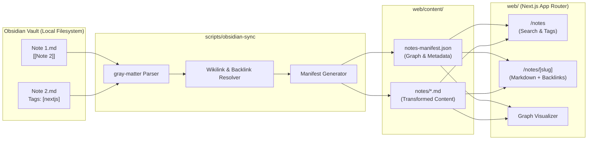

# 🏗️ Architecture & Data Flow

This document details the architecture of the **Next.js Obsidian Loader** workspace.

## High-Level Data Flow

## System Components

### 1. Obsidian Vault
- Stored anywhere on your machine or inside `scripts/obsidian-sync/sample-vault/`.
- Uses standard Obsidian conventions: YAML frontmatter, `[[wikilinks]]`, tags, and aliases.

### 2. Synchronization Pipeline (`scripts/obsidian-sync`)
- Written in TypeScript and executed via `tsx`.
- Recursively traverses markdown files, parsing frontmatter using `gray-matter`.
- Normalizes titles to slugs and replaces `[[Target|Label]]` with web-ready `[Label](/notes/slug)` routes.
- Computes bidirectional relationships (outgoing links and backlinks).
- Generates `notes-manifest.json` for lightning-fast queries and page rendering.

### 3. Web Application (`web/`)
- Powered by Next.js App Router and Tailwind CSS v4.
- Reads `notes-manifest.json` and parsed notes during Server-Side Rendering (SSR) or Static Site Generation (SSG).
- Provides rich note reading, tag filtering, fast search, and backlink exploration.
